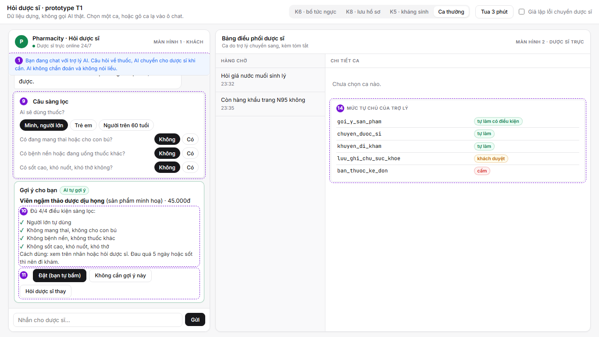

# Prototype · T1 Y tế · Nhóm ConBoBietBay

File: [index.html](./index.html). Mở thẳng bằng trình duyệt, không cần cài gì. Một trang có hai màn hình: bên trái là khách chat trên app, bên phải là bảng điều phối của dược sĩ trực.

- Công cụ: HTML, CSS, JavaScript thuần. Màu, bo góc, viền theo design token của shadcn/ui (theme zinc).
- Phần mock: toàn bộ. Trợ lý nhận ra dấu hiệu nguy hiểm, thuốc kê đơn, nhóm người dùng nguy cơ bằng danh sách từ khoá, thay cho model. Không gọi AI thật, không có backend, dữ liệu đều là dựng.
- Thanh trên có 4 ca dựng sẵn (K6, K8, K5, ca thường). Gõ một câu bất kỳ vào ô chat để thử ca lạ.
- "Tua 3 phút" giả lập khách không phản hồi sau thẻ cấp cứu. "Giả lập lỗi chuyển dược sĩ" cho xem khách thấy gì khi `chuyen_duoc_si` không chạy được.
- Thêm `?annotate` vào cuối đường dẫn để hiện số chú thích, `?case=K6` để mở thẳng một ca.

## Ảnh 1 · K6, bố 68 tuổi tức ngực, khách hỏi men tiêu hoá

| Số | Thể hiện gì | Nguyên tắc | Mức tự chủ |
|---|---|---|---|
| 1 | Dòng báo khách đang chat với trợ lý AI, AI làm được gì và không làm gì | G1, Luật AI 134/2025 điều 11 | |
| 2 | Thẻ đỏ thay cho thẻ sản phẩm, nút Gọi 115, không có nút Đặt | G10 | `khuyen_di_kham` tự làm, `goi_y_san_pham` bị khoá |
| 3 | "Vì sao mình khuyên đi khám", tô màu đúng chữ khách gõ ("68t", "tức ngực", "vã mồ hôi") | G11, PAIR Explainability | |
| 4 | Trạng thái do hệ thống điền khi tool chạy xong, tool lỗi thì hiện "chưa kết nối được dược sĩ, bạn gọi 115 trước" | PAIR Errors | `chuyen_duoc_si` tự làm |
| 5 | "Mình đã gọi 115" và "Mình nhắn nhầm". Nhắn nhầm thì ca vẫn sang dược sĩ, không mở lại nút bán thuốc | G9, PAIR Errors + Graceful Failure | đường chuyển người |
| 12 | Ca gắn cờ NGUY HIỂM nằm đầu hàng chờ, trên các câu hỏi giá | | |
| 13 | Tóm tắt trợ lý soạn cho dược sĩ: người dùng thuốc, triệu chứng, tin nhắn gốc có tô chữ, khách đã bấm gì | PAIR Explainability | |
| 14 | Bảng mức tự chủ của 5 tool | G1 | cả 5 mức |

## Ảnh 2 · K8, nhờ lưu bệnh của mẹ kèm hỏi thuốc giảm đau

| Số | Thể hiện gì | Nguyên tắc | Mức tự chủ |
|---|---|---|---|
| 7 | Nháp ghi chú, ghi rõ lưu gì, cho ai, ai đọc, xoá ở đâu. Bấm "Đồng ý lưu" mới lưu, lưu xong có "Hoàn tác" | G9 | `luu_ghi_chu_suc_khoe` cần khách duyệt |
| 8 | Danh sách điều kiện để AI được tự gợi ý thuốc, ca này trượt 3 điều kiện nên chuyển dược sĩ, có nút huỷ chuyển | G2, G11 | `goi_y_san_pham` không chạy, `chuyen_duoc_si` tự làm |

## Ảnh 3 · ca thường, người lớn đau họng

| Số | Thể hiện gì | Nguyên tắc | Mức tự chủ |
|---|---|---|---|
| 9 | Bốn câu sàng lọc dạng bấm chọn, hỏi trước khi gợi ý | G10 | |
| 10 | "Đủ 4/4 điều kiện sàng lọc", cách dùng chỉ về nhãn hoặc dược sĩ, không nói liều | G2, PAIR Explainability | |
| 11 | Khách tự bấm Đặt, có "Không cần gợi ý này" và "Hỏi dược sĩ thay" | G8 | `goi_y_san_pham` tự làm có điều kiện |

Số 6 không có trong ảnh: bấm tab K5 sẽ thấy thẻ "Bán thuốc kê đơn · AI không làm" màu xám, không có nút mua, chỉ có nút Chuyển dược sĩ (`ban_thuoc_ke_don` cấm).
